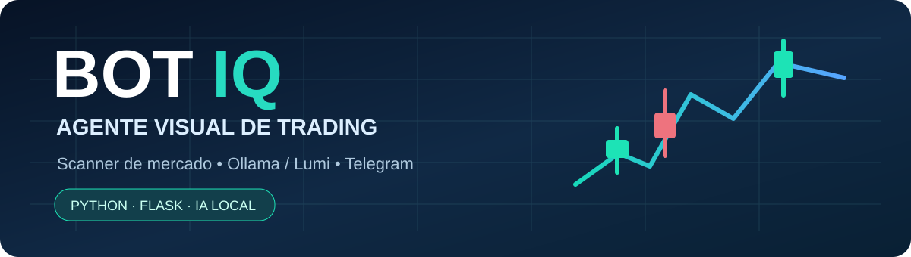

<p align="center"></p>

# BOT IQ — Agente Visual de Trading com IA

**Plataforma local de análise técnica, scanner de oportunidades e execução assistida/automatizada na IQ Option**, com painel de controle em HTML, servidor Flask, integração opcional à **Lumi (Ollama)** e notificações via Telegram.

> **Aviso de risco:** projeto experimental para estudo e testes. Operações com opções binárias e mercados financeiros podem resultar na perda integral do capital empregado. Indicadores, IA, martingale, limites de perda e histórico **não garantem resultados futuros**. Priorize a conta **PRACTICE** e conheça os riscos, os termos da corretora e as regras aplicáveis à sua região.

## Visão geral do sistema

O BOT IQ reúne o fluxo operacional em um único painel:

```text
Configurar credenciais e conta → conectar à IQ Option
             ↓
Scanner de ativos + análise técnica + estratégias
             ↓
Filtro opcional Lumi / Ollama + regras de risco
             ↓
Sinal, observação ou decisão de entrada
             ↓
Operação automática ou manual CALL / PUT
             ↓
Acompanhamento → resultado → histórico → laboratório
```

A interface apresenta **modo Fácil** e **modo Avançado**, controles para iniciar/parar o bot e áreas de acompanhamento em tempo real.

## Painel operacional — tudo o que pode ser configurado

### 1. Conexão e contas

- Login com e-mail e senha da IQ Option.
- Escolha entre **PRACTICE** (treinamento) e **REAL** (dinheiro verdadeiro).
- Opção de guardar as credenciais **somente no computador local**.
- Fluxo de confirmação/autenticação adicional quando solicitado.
- Conectar e alternar a conta operacional.
- Exibição do saldo e do estado da conexão.

**Atenção:** a integração utiliza `iqoptionapi`, biblioteca de terceiros **não oficial**, sujeita a alterações e indisponibilidade.

### 2. Modo Fácil

Interface de configuração resumida com:

- Perfil de operação **Conservador**, **Equilibrado** ou **Agressivo DEMO**.
- Modo **Observação**, destinado a analisar sem priorizar entradas.
- Valor por entrada, **Stop Win** e **Stop Loss**.
- Seleção da estratégia e do tipo de mercado.
- Filtro opcional por IA Lumi.
- Fallback para análise técnica quando a Lumi não estiver disponível.
- Recuperação inteligente após LOSS, com parâmetros de controle.
- Quantidade máxima de perdas consecutivas.
- Botões para salvar a configuração e abrir o modo Avançado.

Os perfis são **presets de parâmetros**, não classificações confiáveis de risco de mercado.

### 3. Modo Avançado — operação e estratégias

Configurações identificadas na interface:

- Seleção do ativo e de expiração: **1, 5 ou 15 minutos** e **1 hora**.
- Valor por operação.
- Seleção automática de estratégias ou escolha manual.
- Mercado: **OTC**, **Forex/Binárias + Cripto** ou **somente Cripto**.
- Escolha entre ativos como EUR/USD, GBP/USD, USD/JPY, AUD/USD, EUR/GBP, EUR/JPY, BTC/USD e ETH/USD, sujeitos à disponibilidade da corretora.
- Controles de scanner e seleção de oportunidades.

**Estratégias disponíveis na interface:** Tendência EMA 9/21, Suporte/Resistência, RSI + Bollinger, Breakout Consolidação, Divergência MACD, Scalp Estocástico, Combinada Balanceada, Trend Sniper Pro, Pullback Inteligente, Breakout Volatilidade, Reversal Pro, Volatility Flow, Price Action Curto, EMA + MACD Sync, Mean Reversion S/R, Volatility Breakout Pro e Adaptive Trend Pullback.

Há ainda opções de análise como **RSI Extremo**, **Cruzamento EMA**, **MACD** e **Bollinger Bands**. A presença de uma estratégia no menu não comprova rentabilidade.

### 4. Scanner e seleção de oportunidades

- Busca automática pela melhor oportunidade disponível.
- Perfil de entrada e confiança técnica mínima.
- Limite de ativos avaliados no scanner.
- **TOP Lumi:** sempre TOP 1, TOP 2 quando a primeira opção for HOLD, ou seleção adaptativa de testes.
- Função **Anti-paralisia DEMO**, com tempo sem entradas, pisos de confiança e quantidade máxima de oportunidades enviadas à IA.
- Detalhamento técnico opcional nos logs.
- Ajuste da janela de entrada no início de velas.
- Botão **Escanear agora**.
- Leitura de **Sinais** e **Análises** no painel.

### 5. Gestão de risco

- Stop Win e Stop Loss por sessão.
- **Payout mínimo** exigido.
- Cooldown entre entradas.
- Número máximo de operações por sessão.
- Parada após sequência de perdas.
- Exposição máxima relativa ao saldo.
- Validação/revalidação do sinal na abertura da vela.
- Cancelamento de ordem quando a direção muda de **CALL para PUT** ou vice-versa.
- Bloqueio temporário do ativo após reversão cancelada.

**Martingale Inteligente V108** possui controles de fator máximo, níveis, confiança técnica e da Lumi, payout, amostra e edge mínimo de laboratório, recuperação por velas, sequência máxima de LOSS, aprovação do Risk Gate por IA e timeout de decisão. Há opção de exigir confirmação final do Ollama/Lumi e de permitir entrada normal com valor-base quando a IA rejeita uma recuperação.

O menu também apresenta **Martingale simples restrito a DEMO/PRACTICE**, com fator e sequência configuráveis. **Martingale pode ampliar rapidamente as perdas.**

### 6. Inteligência artificial — Lumi / Ollama

- Motor **Ollama local**, sem quota externa do Gemini, ou opção de endpoint PHP/Gemini legado.
- Configuração de URL do Ollama, modelo e endpoint da Lumi.
- Confiança mínima exigida da IA.
- Timeout, intervalo mínimo entre chamadas e cache de análises.
- Chamada da IA somente após atingir um piso técnico configurado.
- Cooldown após erro de quota/HTTP 429.
- Limite diário local de chamadas de IA, com opção de reset.
- Bloqueio temporário de ativos após HOLD/divergência.
- Botão **Testar Lumi**.
- Histórico **Decisões da Lumi** e área **Lumi Agent**.

### 7. Fallback técnico

Se a IA não estiver disponível, o sistema oferece controles para fallback baseado em análise técnica:

- Habilitar ou desabilitar fallback.
- Regras distintas para **PRACTICE** e **REAL**.
- Confiança técnica e payout mínimos específicos.
- Limite de usos de fallback por sessão.

O fallback em REAL exige avaliação cuidadosa: continuar operando sem o filtro de IA **não reduz** necessariamente o risco.

### 8. Cérebro visual, aprendizado e laboratório

- Opção **Ativar cérebro visual** e escolha do estilo do MiroFish.
- Estilos de visualização, incluindo Trading Cockpit, Neural Core, Radar Scanner, HUD Minimal Pro, Quantum Orbit e outros.
- Aprendizado de padrões após operações com resultado LOSS, com bloqueios por ativo/direção, redução temporária de confiança e limiar de similaridade.
- **Laboratório de sinais**, com registros e métricas para análise.
- Geração de estratégias por IA, com comando **Gerar estratégia agora** e limites baseados em quantidade de novos WINs.
- Configurações de calibração adaptativa.

Esses mecanismos são experimentais e não demonstram, por si só, que o sistema aprenda padrões generalizáveis ou tenha vantagem estatística.

### 9. Operação manual e controles de execução

- Botões manuais **CALL** e **PUT**.
- **Iniciar Bot** e **Parar Bot**.
- Alternância PRACTICE/REAL.
- Monitoramento de estado, sinais e atividade.
- Backup manual pela opção **Backup agora**.

### 10. Histórico, relatórios e auditoria operacional

A interface disponibiliza:

- Resumo de **Sessão atual**, **Hoje** e **Histórico REAL**.
- **Histórico diário** e atualização sob demanda.
- Painéis de **Sinais**, **Análises**, **Laboratório**, **Lumi Agent** e **Logs**.
- Histórico de operações REAL, com filtros por status, estratégia, resultado e tipo CALL/PUT.
- Histórico de decisões **TRADE**, **WATCH** e **REJECT**, com filtros por entrada e resultado.
- **Reconciliação de operações pendentes** e possibilidade de registrar resultado manual em situações específicas.
- Botões para atualizar decisões, copiar e limpar logs.
- Indicação de WIN e LOSS nos históricos.

**Importante:** reconciliação trata inconsistências de status ou resultado, não assegura execução da ordem nem correção automática de prejuízos.

### 11. Integração Telegram

- Configuração de **Bot Token** e **Chat ID**.
- Teste de envio por botão.
- Notificações configuráveis de conexão/início/parada, sinais, WIN/LOSS, decisões da Lumi, erros e resumo diário.
- Opção de comandos como `/saldo` e `/stop`, conforme configuração da integração.

### 12. Configuração JSON e diagnóstico

- Salvar/aplicar, apagar ou importar `config.json`.
- Opção de aplicar configurações e reiniciar o bot quando necessário.
- Visualizar e copiar o JSON salvo.
- Diagnóstico de estado e saúde da aplicação.
- Alternância entre tela cheia e visualizações do painel.

## Interface de API local

O servidor Flask inclui rotas para:

| Função | Exemplos de endpoints |
|---|---|
| Estado e diagnóstico | `/status`, `/status_fast`, `/runtime_health`, `/api/health` |
| Configuração | `/config`, `/config/upload` |
| Conta e bot | `/connect`, `/connect_2fa`, `/switch_account`, `/start`, `/stop` |
| Mercado e operação | `/assets`, `/scan_now`, `/manual_trade` |
| IA | `/lumi_test`, `/lumi_decision_history`, `/api/agent-status` |
| Laboratório | `/signal_lab`, `/api/adaptive-calibration`, `/strategy_factory` |
| Histórico REAL | `/real_operation_history`, `/real_order_reconcile`, `/real_order_manual_result` |
| Relatórios e suporte | `/daily_summary`, `/backup`, `/telegram_test`, `/log/clear` |

**Não exponha essas rotas na internet** sem autenticação, autorização, proteção contra requisições indevidas e revisão de segurança.

## Requisitos

- **Windows** e **Python 3.13** (ambiente previsto neste projeto).
- Flask, Flask-CORS, Requests e dependências listadas em `requirements.txt`.
- Biblioteca externa `iqoptionapi`.
- **Ollama**, caso deseje habilitar a IA local.
- Acesso de rede à corretora e ao Telegram, quando configurados.

## Instalação

```powershell
git clone https://github.com/thayro/bot-iq.git
cd bot-iq
py -3.13 -m venv .venv
.\.venv\Scripts\python.exe -m pip install -r requirements.txt
.\.venv\Scripts\python.exe iqbot_server.py
```

Abra o endereço local informado pelo servidor no terminal e configure a conta **PRACTICE** antes de testar sinais e operações. O projeto também possui `INICIAR_BOT.bat` e `instalar_lumi_trader_fast.ps1`, que devem ser revisados conforme o ambiente.

## Estrutura do repositório

| Arquivo | Responsabilidade |
|---|---|
| `iqbot_server.py` | Flask, integrações, execução, scanner, risco, logs e históricos |
| `iqbot_ui.html` | Painel completo e suas configurações |
| `requirements.txt` | Bibliotecas necessárias |
| `INICIAR_BOT.bat` | Inicialização no Windows |
| `Modelfile.lumi-trader-fast` | Definição do modelo local |
| `instalar_lumi_trader_fast.ps1` | Instalação/configuração da Lumi |
| `docs/banner.svg` | Capa do repositório |
| `.gitignore` | Exclusão de credenciais e arquivos locais |

## Segurança e privacidade

**Nunca publique** `config.json`, senhas, tokens Telegram, cookies de autenticação, arquivos de sessão, relatórios privados, backups ou logs operacionais. O `.gitignore` impede apenas novos arquivos não rastreados; não remove segredos já incluídos em commits anteriores.

O sistema foi projetado para ambiente **local**, e os controles da interface podem provocar operações financeiras. **Não execute o servidor aberto à internet ou numa rede não confiável sem segurança adicional**.

## Limitações e responsabilidades

- O programa e suas integrações podem falhar devido a redes, bibliotecas e plataformas externas.
- A conta REAL movimenta dinheiro verdadeiro.
- Simulações, WIN rate, análise técnica, inteligência artificial e estratégias não garantem retorno financeiro.
- Confirme permissões, legislação aplicável e termos da IQ Option antes de utilizar qualquer automação.
- A presença das funções na interface e no servidor foi verificada por leitura do código; esta documentação **não é evidência de testes funcionais ponta a ponta**.

## Licença

O projeto ainda não possui arquivo `LICENSE`. A publicação no GitHub não significa automaticamente autorização ampla de reutilização.
